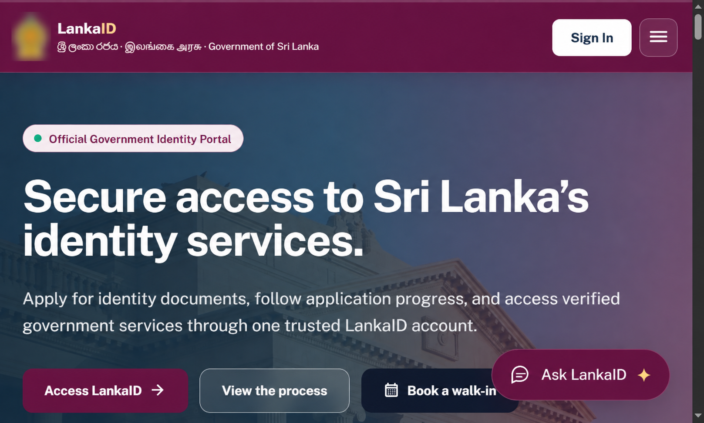
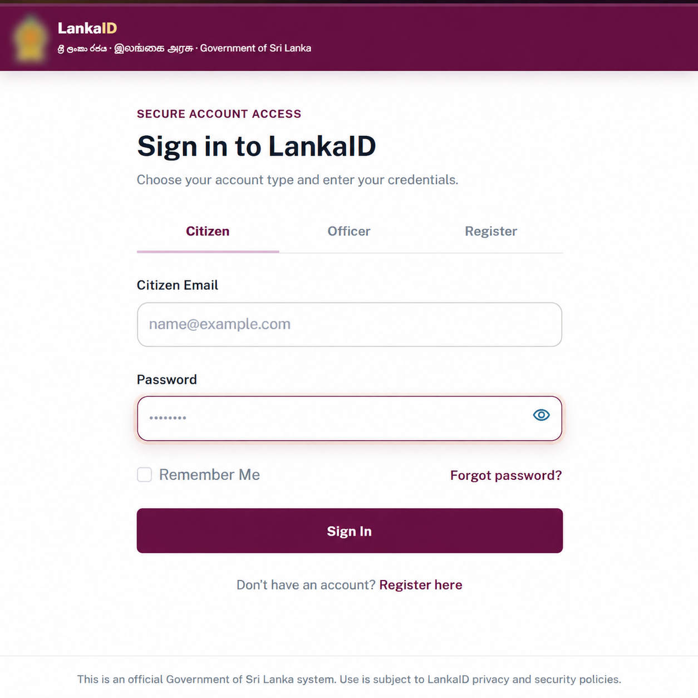
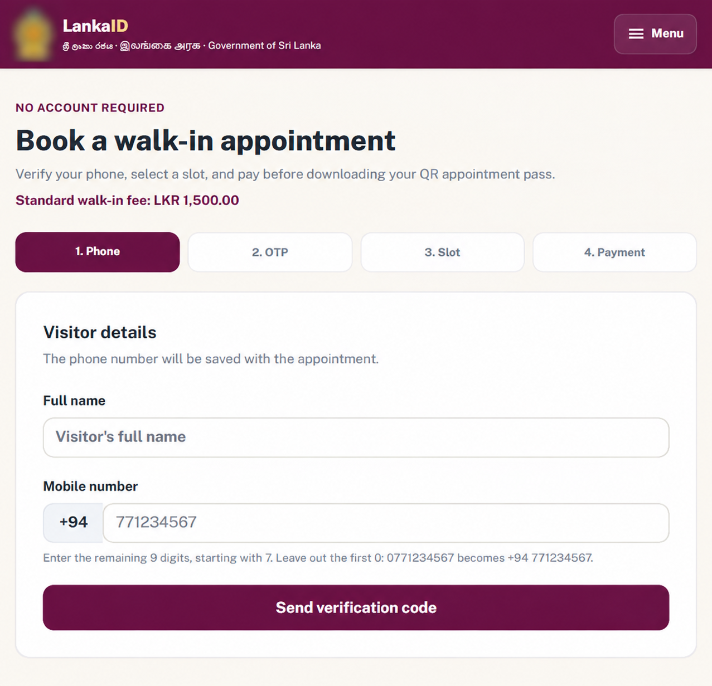

# LankaID

**NIC and passport services in one citizen portal.**

LankaID is a university group project that brings citizen applications, officer review, biometric appointments, and document delivery into a single web application. Built for **SE2030 – Software Engineering**, Year 2 Semester 1, at **SLIIT**.


[Screenshots](#screenshots) · [Features](#features) · [Run locally](#run-locally) · [Project structure](#project-structure) · [Team](#team)

> **Academic demonstration only.** LankaID is a student project, not an official government service. Do not deploy it in production or use it to collect, store, or process real citizen data. Use fictional test data only. See the [disclaimer for anyone cloning this repository](#academic-use-disclaimer).

## Screenshots

Screenshots of the academic prototype, with the government emblem blurred for presentation. Government names, branding, and official-sounding interface text are illustrative only and do not imply affiliation, authorization, or endorsement.



| Citizen sign-in | Walk-in appointment booking |
| --- | --- |
|  |  |

## Features

- **Citizen applications** — Apply for a NIC or passport, save drafts, upload supporting documents, and track progress.
- **Renewals and replacements** — Link an existing identity record and request a document renewal or lost-document replacement.
- **Officer review** — Review applications in role-specific queues, request corrections, approve or reject requests, and refer cases to the director.
- **Appointments and QR passes** — Publish biometric slots, book or reschedule visits, and check in using a QR pass or reference number.
- **Issuance and delivery** — Export printing registers and track home delivery or collection from a service centre.
- **Support and administration** — Manage walk-in appointments, support requests, staff accounts, service centres, public announcements, and maintenance mode.

## How it works


Citizens use the self-service portal. NIC and passport officers handle reviews and biometric visits; customer service representatives handle walk-ins and support. The director oversees referrals and printing, while the administrator manages staff and system settings.

## Built with

| Layer | Technology |
| --- | --- |
| Backend | Java 17, Spring Boot, Spring MVC |
| Frontend | Thymeleaf, HTML, CSS, JavaScript |
| Persistence | Spring Data JPA, Microsoft SQL Server |
| Authentication | Session-based access, BCrypt password hashing, email and SMS OTP |
| QR codes | ZXing and jsQR |
| Build and tests | Maven Wrapper, JUnit, Mockito |

The backend is organized by feature, with controllers, services, repositories, and models within each module. Thymeleaf renders the pages on the server; no separate frontend build is needed.

## Run locally

### 1. Prerequisites

- JDK 17 or a compatible newer JDK.
- Microsoft SQL Server 2019 or newer, with SQL Server Management Studio (SSMS).
- An email sender and a compatible SMS gateway to use registration and other OTP flows.

### 2. Clone the repository

```powershell
git clone https://github.com/aakilahamed2005/LankaID.git
cd LankaID
```

### 3. Create the database

Open [database/current-database-schema.sql](database/current-database-schema.sql) in SSMS and execute the entire file. It creates `identity_issuance_service`, all 26 tables, constraints, indexes, and default settings.

Use a **fresh or empty database**. The script refuses to overwrite existing application tables and contains no citizen sample data.

### 4. Configure your connections

Review [application.properties](src/main/resources/application.properties) for the database and external services. The default database connection uses Windows integrated authentication on `localhost:1433`; it requires the Microsoft JDBC authentication library to be available to the JVM. Adjust the connection for your SQL Server instance.

For SQL Server authentication instead, set these environment variables in the terminal used to launch the app:

```powershell
$env:SPRING_DATASOURCE_URL="jdbc:sqlserver://localhost:1433;databaseName=identity_issuance_service;encrypt=true;trustServerCertificate=true;sendTimeAsDatetime=false;"
$env:SPRING_DATASOURCE_USERNAME="your-database-user"
$env:SPRING_DATASOURCE_PASSWORD="your-database-password"
```

Configure email and SMS delivery in the same terminal:

```powershell
$env:LANKAID_MAIL_USERNAME="your-email@gmail.com"
$env:LANKAID_MAIL_APP_PASSWORD="your-gmail-app-password"
$env:APP_SMS_URL="http://your-sms-gateway:8080/sms"
$env:LANKAID_SMS_API_KEY="your-sms-api-key"
```

Keep credentials in your local environment rather than committing them to the repository.

### 5. Start the application

```powershell
.\mvnw.cmd spring-boot:run
```

Open [localhost:8080](http://localhost:8080). On macOS or Linux, use `./mvnw` instead of `.\mvnw.cmd`.

<details>
<summary>Initial administrator login</summary>

On first startup, the application creates the demo administrator:

| Field | Value |
| --- | --- |
| Email | `admin@gov.lk` |
| Password | `admin12345` |
| Login | Officer tab → System Administrator |

`UserAccount` stores the login details and BCrypt password hash. `StaffAccount` stores employee number `ADMIN-001` and role `SYSTEM_ADMIN`, linked by the same user ID. Later startups preserve the saved password and account status.

</details>

## Testing

```powershell
# Run the full suite; some integration tests require a configured database
.\mvnw.cmd test

# Run the admin and schema consistency checks
.\mvnw.cmd "-Dtest=AdminAccountServiceTests,UiAndSchemaConsistencyTests" test
```

Tests cover application workflows, validation, role access, payments, appointments, notifications, and support services. See [src/test/java](src/test/java/lk/sliit/identityissuanceservice) for the test classes.

## Project structure

```text
LankaID/
├── .mvn/wrapper/                 # Maven wrapper configuration
├── docs/screenshots/             # Application screenshots used in this README
├── database/
│   └── current-database-schema.sql
├── src/
│   ├── main/
│   │   ├── java/                # Feature modules and backend logic
│   │   └── resources/
│   │       ├── static/          # CSS, JavaScript, images and reference data
│   │       ├── templates/       # Citizen and staff pages
│   │       └── application.properties
│   └── test/java/               # Unit and integration tests
├── mvnw / mvnw.cmd
├── pom.xml
└── README.md
```

## Team

LankaID was developed as a five-member university group project using the members' **university GitHub accounts**, identified by their IT student numbers. This repository is shared on **Aakil Ahamed's personal GitHub account**; the original group contributions remain credited to their authors.

The IT numbers shown in the commit history and contributor names identify the following members:

| University GitHub account / student ID | Team member | Main responsibility |
| --- | --- | --- |
| **IT25101235** | **Aakil Ahamed — Marickar A A A** | User management; verification and approval |
| **IT25100689** | **Jeniviya G A** | Citizen application management |
| **IT25100565** | **Weerakoon W M Y B** | Biometric and appointment management |
| **IT25100885** | **Rithika R K** | Document renewal, replacement and delivery |
| **IT25100604** | **Dharshan S** | Citizen support and service management |

For example, a contribution by `IT25101235` is a contribution by **Aakil Ahamed (Marickar A A A)**. Commits may also display a member's name or university email (`it<number>@my.sliit.lk`) instead of the IT account name. The table records the main module assignments; shared services connect the members' work.

## Academic-use disclaimer

LankaID was created solely for university coursework, learning, and academic demonstration. It is **not an official Government of Sri Lanka service**, is not affiliated with or endorsed by any government agency, and must not be presented as an authorized identity-issuing system. Government names, emblems, and interface wording are used only to illustrate the academic scenario.

**For anyone who clones, forks, runs, or demonstrates this repository:**

- Use it only in a local or isolated test environment with fictional or synthetic data.
- **Do not use it in production, offer it as a public citizen service, or collect, store, upload, or process real citizen data.** This includes real NIC/passport numbers, birth certificates, photographs, biometric data, contact details, and payment information.
- Do not use it for impersonation, fraud, unauthorized identity verification, unlawful data collection, or any other illegal or deceptive purpose. The authors do not intend or authorize such use.
- Payments, biometric capture, and document production are demonstrations. The project is not connected to government identity systems or authorized to verify identities or issue official documents.
- The code is provided as an academic prototype, without guarantees of security, privacy, correctness, availability, or fitness for real-world use. Anyone using a copy is responsible for keeping it within this academic scope and complying with applicable rules and laws.

Citizen registration requires configured email and SMS delivery. Use only test accounts and contact destinations you control when demonstrating these integrations.

No open-source license has been added to this repository.
